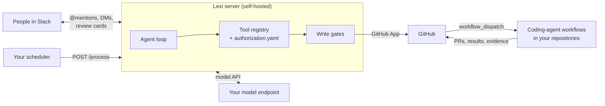

# Lexi

A self-hosted AI teammate for engineering teams. It lives in Slack and works in GitHub.

Mention Lexi in a Slack thread and it reads the issues, pull requests, CI runs, logs and
files it needs to answer you. Ask it to act and it can comment, close an issue, open a
branch and a pull request, or hand a bug to a coding agent that comes back with a fix PR.
Point it at a spec and it can build an app, session by session, behind a draft PR you
steer. Every one of those actions is checked against an access policy you write, for the
person who asked, before it runs.

## What Lexi does

- **Answers and acts in Slack.** @mention it in a thread or send it a direct message.
  Ask *"why did CI fail on #123?"* and it reads the workflow run and its logs. Ask it to
  close a stale issue, comment on a PR, open a branch or post a summary to a channel, and
  it does, if you are allowed to. It merges only open, non-draft PRs whose checks pass,
  and not into the default branch unless you configure that.
  See the [capability matrix](docs/capability-matrix.md) for every tool.
- **Triages bug reports.** Send an issue to `POST /process` and Lexi classifies it (needs
  more information, likely a duplicate, likely fixed, needs a person to look), finds its
  owner from [`ownership.yaml`](examples/config/ownership.yaml), notifies them in Slack,
  and comments, labels or closes on GitHub. See
  [architecture](docs/architecture.md#post-process).
- **Fixes bugs.** Ask Lexi to fix a bug from the thread it was reported in. A coding agent
  investigates in your repository, opens a fix PR, waits for real CI and ends with one
  result, shipped or handed back, which Lexi reads back into the thread. A second workflow
  keeps agent PRs rebased on their base branch. See [agent-fix](docs/agent-fix.md).
- **Builds whole apps.** One builder agent builds an app on one branch, session after
  session, behind a draft PR. Comment on the PR to steer it; label or close it to stop it.
  Start, steer and stop it from Slack too, once you opt in with `APP_BUILD_ENABLED`. See
  [app-build](docs/app-build.md).
  **Lexi·Build** runs the same idea on your own machine: a crew of agent personas (Scout,
  Pixel, Words, Data, Forge, Check and Probe, managed by Lexi) goes from intent to spec,
  plan, wireframe, prototype, build and review to ship, and stops for your approval before
  it builds and before it ships. See [`apps/build`](apps/build/README.md).
- **Runs rebuild programmes.** For a larger rebuild, Lexi turns a spec and a design into
  milestones and a graph of build tasks, dispatches ready tasks to coding agents in
  parallel, checks each one against the test evidence it posts back, merges what passes
  when you allow auto-merge, and asks a person to approve each milestone from a card in
  Slack. Opt in with `PROGRAMME_ENABLED`. See the
  [programme contract](docs/programme-contract.md).
- **Remembers.** Tell it your preferences, or teach it a team convention, and it recalls
  them in later conversations. Ask it to forget and it does. What it keeps, and for how
  long, is set in [`memory-policy.yaml`](examples/config/memory-policy.yaml).

<!-- TODO: demo GIF of a Slack thread turning into a fix PR -->

## Why teams trust it

The model decides *what* to do. Deterministic code decides *whether* it may.

- **Your access policy, per person.** Every tool call, reads included, is checked against
  your own [`authorization.yaml`](examples/config/authorization.yaml) for the person who
  asked and their team. Anything short of an explicit yes is a no.
- **Identity comes from Slack, not the model.** The person behind a request is the Slack
  user who sent it. Nothing the model writes can change that.
- **Writes are off until you turn them on.** `GOVERNED_WRITES_ENABLED=false` and a dry-run
  switch stop every GitHub and Slack write at the gateway, so you can watch what Lexi would
  do first.
- **It says what actually happened.** Every tool result records whether the action ran,
  and Lexi is told to report exactly that.
- **Self-hosted.** It runs on your infrastructure, against your model endpoint, and sends
  no telemetry.
- **Personal data is masked before it reaches the model.** Emails, phone numbers, card
  numbers, IBANs and IP addresses in messages, issues and tool results are replaced with
  placeholders, on by default ([what goes to the model](docs/governance-model.md#what-goes-to-the-model)).
- **Documented from the code.** The [capability matrix](docs/capability-matrix.md) is
  generated from the tool modules, and the [threat model](docs/threat-model.md) lists the
  known gaps alongside the mitigations.

Read the [governance model](docs/governance-model.md) for the detail.

## How it works



The server is one long-running process. It connects to Slack over Socket Mode, so it needs
no public URL, and to GitHub as a GitHub App. Coding agents never run inside it: they run in
GitHub Actions in your own repositories, through reusable workflows from this repository,
with a separate, narrower GitHub App. See [architecture](docs/architecture.md).

## Quick start

```bash
cp .env.example .env    # fill in Slack, GitHub and model credentials
docker compose -f examples/docker-compose.yml up
curl http://localhost:3000/health/ready
```

Writes are off by default (`GOVERNED_WRITES_ENABLED=false`). Keep them off until you have
read the [governance model](docs/governance-model.md). People not listed in
`authorization.yaml` get no governed tool, reads included. The full steps, including the
Slack app ([`examples/slack-manifest.yml`](examples/slack-manifest.yml)) and the GitHub
Apps, are in [getting started](docs/getting-started.md).

## Documentation

| Document | For |
|---|---|
| [Getting started](docs/getting-started.md) | Create the Slack app, the server's GitHub App and a separate workflow App, configure, run locally, first @mention, `POST /process`. |
| [Architecture](docs/architecture.md) | Packages, the Slack and `POST /process` lifecycles, the reusable workflows. |
| [Governance model](docs/governance-model.md) | Roles and permissions, fail-closed rules, the two write gates, limits, honest outcomes, adding a tool. |
| [Capability matrix](docs/capability-matrix.md) | Every tool the agent can call, whether it changes anything, and the permission it needs. Generated from the code. |
| [Threat model](docs/threat-model.md) | Assets, trust boundaries, threats, mitigations and known gaps. |
| [agent-fix](docs/agent-fix.md) | Setting up a repository for agent-made fix PRs. |
| [app-build](docs/app-build.md) | The session-by-session app builder. |
| [Programme contract](docs/programme-contract.md) | The wire contract of the programme workflows. |
| [Lexi·Build](apps/build/README.md) | The local builder crew. |
| [Example configuration](examples/config/README.md) | What each policy file controls. |

## Repository layout

- [`apps/server`](apps/server): the server. Slack conversations, `/health`, `/metrics`
  and the bearer-token issue actions (`POST /process`, `/reprocess`, `/retest`), plus the
  app-build tools and the rebuild programme when they are switched on.
- [`apps/build`](apps/build/README.md): Lexi·Build, the local builder crew. Start it with
  `npm start -w @lexi/build`.
- [`packages/`](packages): the agent runtime, the tool modules, the policy engine, the
  GitHub and Slack adapters, memory, ownership, the issue workflow engine and the
  programme. See [architecture](docs/architecture.md#packages).
- [`.github/workflows`](.github/workflows): the reusable workflows your repositories
  call: [`agent-fix`](docs/agent-fix.md), [`rebase-branch`](docs/agent-fix.md),
  [`app-build`](docs/app-build.md) and [`programme-*`](docs/programme-contract.md).
  Callers to copy are in [`examples/workflows`](examples/workflows).
- [`examples/`](examples): policy files for a fictional organisation, a Compose file and
  the Slack app manifest.

## Status

Lexi is an early release. Everything described above runs today. Some libraries in the
repository, such as the spec tools, the duplicate-detection pipeline and the run budgets,
are not yet wired into the server, and triage classifies an issue without first trying to
reproduce it; [architecture](docs/architecture.md#what-the-server-wires-today)
marks which. Expect configuration and APIs to change between releases.

## Development

```bash
npm install
npm run prisma:generate
npm run build           # tsc -b over every package
npm test                # vitest
```

`npm run check` runs the build, lint, tests, the leak scan and the licence check, as CI
does. After changing a tool module, regenerate the capability matrix with
`npm run docs:capability-matrix`; a spec fails while it is stale.

## Contributing, security and licence

- Contributions are welcome. Start with [CONTRIBUTING.md](CONTRIBUTING.md) and the
  [code of conduct](CODE_OF_CONDUCT.md).
- Report vulnerabilities privately; see [SECURITY.md](SECURITY.md). The
  [threat model](docs/threat-model.md) lists what is and is not mitigated today.
- Licensed under the [Apache License, Version 2.0](LICENSE).
