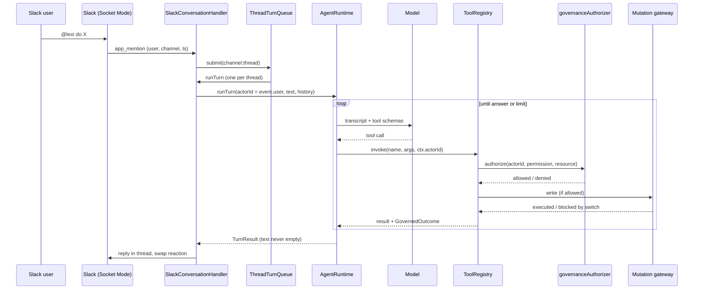

# Architecture

This page explains what happens between someone asking Lexi for something and
Lexi doing it: how a Slack message becomes an answer or a governed action, how
a bug report sent to `POST /process` is triaged, and how coding agents in your
repositories are started and report back. Read it to know where each check
sits and which parts of the code to change for a given behaviour.

Lexi is a TypeScript monorepo (npm workspaces, `tsc -b` project references).
One long-running server, `apps/server`, answers Slack and exposes a small HTTP
API. It is a composition root: the behaviour lives in the packages under
`packages/`. Coding work happens elsewhere, in reusable GitHub workflows that
run in your own repositories.

This page describes what the code in this repository does today. Parts that
exist as libraries but are not wired into the server are marked as such. For
the list of tools the agent can call and the permission each needs, see the
[capability matrix](capability-matrix.md).

## Packages

One line each, from each package's `package.json` and its code.

| Package | What it does |
|---|---|
| `apps/server` | NestJS composition root: the Slack conversation surface (Socket Mode), `/health`, `/metrics`, the bearer-token issue actions `POST /process`, `/reprocess`, `/retest`, and the programme's runner routes under `/api`, which refuse while the programme is off. |
| `apps/build` | Lexi·Build: a local web UI and a loopback-only Node bridge that runs a crew of agent CLIs through one product build on your machine. Separate from the server. |
| `packages/agent` | The agent runtime: the tool-calling loop (`AgentRuntime`), the fail-closed `ToolRegistry`, context budgeting, repeat detection, prompt composition and the LLM clients. |
| `packages/agent-tools` | Tool modules for the runtime: GitHub reads, governed GitHub writes, agent-fix and rebase dispatch, Slack, work items, memory and specs, plus the adapter from the governance authorizer to the registry. |
| `packages/ai` | The decision engine: structured LLM reasoning over evidence for the issue workflow. It never writes to GitHub, Slack or the database. |
| `packages/app-build` | The app-build agent tools and `AppBuildService` behind them, parsers for the session reports and assessments the workflow posts, an audit-log store, and channel-to-repository bindings. |
| `packages/config` | Zod-validated environment loader. A missing required value stops the server at boot. |
| `packages/contracts` | Cross-package TypeScript types, including the programme brief, result and evidence shapes. |
| `packages/database` | Prisma schema (68 models), client and a NestJS `PrismaService`. |
| `packages/figma` | A client for the public Figma-hosted MCP server, design-link parsing, read and write gateways, and a visual review of prototype screenshots. |
| `packages/github` | Octokit-backed GitHub provider, and `GitHubMutationGateway`, which every GitHub write passes through. |
| `packages/governance` | The policy engine: `AuthorizationService`, action classification, blast radius, run budgets, protected paths and branches, intake and duplicate detection. |
| `packages/logger` | Pino-based structured logging. |
| `packages/memory` | Working, episodic, semantic and hierarchical-buffer memory behind one budget-capped `MemoryPort`, and `createPrismaMemoryFacade`, which stores it in Postgres. |
| `packages/metrics` | The Prometheus registry served at `/metrics`. |
| `packages/notifications` | Slack notification templates and the escalation ladder. |
| `packages/ownership` | Resolves who owns an issue from `ownership.yaml` (module by platform). |
| `packages/privacy` | The dependency-free PII masker the model clients apply to everything they send (see [What goes to the model](governance-model.md#what-goes-to-the-model)). |
| `packages/programme` | The rebuild programme: programme, milestone and build-task state machines, the task graph, the build service that dispatches and folds results, the auto-merge and hardening gates, milestone review, its agent tools, and the policy loader. |
| `packages/slack` | The Bolt adapter, `BoltSlackProvider`, and `SlackMutationGateway`. |
| `packages/specs` | The clarification loop and spec pipeline: coverage, a deterministic stop condition, question policy and rendering. |
| `packages/workflows` | The issue state machine and `WorkflowOrchestrator`, which drives an issue from intake to closure, with its verification, escalation and closure policies. |
| `packages/workitems` | Work-item lifecycle and the role-aware repository registry loaded from `repos.yaml`. |

### What the server wires today

[`apps/server/src/wiring/runtime-wiring.ts`](../apps/server/src/wiring/runtime-wiring.ts)
builds the agent and the workflow engine, and
[`programme-wiring.ts`](../apps/server/src/wiring/programme-wiring.ts) builds
the rebuild programme. The server registers:

- the default tool modules `createDefaultToolModules` builds from what it is
  given: GitHub reads (governed by `issue.read`), GitHub writes, agent-fix
  dispatch, work items, Slack, and memory (backed by `createPrismaMemoryFacade`,
  switched on by `memory-policy.yaml`);
- the app-build tools, when `APP_BUILD_ENABLED=true`, with the status read
  governed by `actions.read`;
- the programme tools, its Slack review-card handler and a ticker, when
  `PROGRAMME_ENABLED=true`. Its HTTP routes are always registered and refuse
  while it is off; evidence ingest has its own switch,
  `EVIDENCE_INGEST_ENABLED`;
- the issue workflow behind `POST /process`, with its Slack notifications sent
  through `SlackMutationGateway`.

Not wired into the server, although the libraries exist:

- the spec tools (no spec executor is passed) and the product-knowledge index;
- the blast-radius guard (`GuardedMutationGateway`, `MutationGuard`) and the run
  budgets from `@lexi/governance`;
- schedulers, intake watchers, duplicate detection and the other flags in
  `.env.example`;
- an `AgentObserver` for tool-call audit or metrics;
- `AppBuildWatcher`, which would relay app-build reports into Slack;
- a real reproduction provider (the server uses `NoopReproductionProvider`).

A piece whose prerequisites are missing is replaced by one that fails at call
time with `NotWiredError`: with no model key, every Slack turn ends in an error
reply; with no GitHub credentials or no model key, `POST /process` answers 501.
The server still boots, and health and metrics still work. The app-build and
programme switches log a warning and stay off when GitHub credentials or
`repos.yaml` are missing.

## Slack @mention lifecycle

1. **Connect.** `SlackSurface` connects the Bolt app over Socket Mode once the
   server is up, but only when `SLACK_AGENT_ENABLED=true` and `SLACK_APP_TOKEN`
   is set. It calls `auth.test` to learn the bot's own user and bot IDs
   ([`slack-surface.ts`](../apps/server/src/slack/slack-surface.ts)).
2. **Accept.** `SlackConversationHandler.handleEvent` receives `app_mention` and
   `message` events. It ignores anything without a human `user`, anything with
   a `bot_id`, the bot's own messages, edits and joins, and plain channel
   messages (it answers plain messages only in direct messages). It drops a
   duplicate of the same `channel:ts` seen within 30 seconds. Before any model
   call it drops a person over their turn rate limit (`SLACK_USER_TURN_LIMIT`
   per `SLACK_USER_TURN_WINDOW_MS`, telling them once per window) and refuses a
   person the policy refuses everything (`AuthorizationService.accessRefusal`:
   unlisted while `unknownUserRole` is `denied`). Then it strips the mention
   and adds an :eyes: reaction
   ([`slack-conversation.handler.ts`](../apps/server/src/slack/slack-conversation.handler.ts)).
3. **Queue.** The per-thread queue, `ThreadTurnQueue`, keyed by
   `channel:thread_ts`, runs one turn at a time per thread. A message for a
   busy thread waits; beyond `SLACK_THREAD_QUEUE_MAX` it is refused with a
   reply saying so; one that waited more than ten minutes is told it was not
   answered late. The queue is in memory and is lost on restart
   ([`thread-turn-queue.ts`](../apps/server/src/slack/thread-turn-queue.ts)).
4. **Build the turn.** `fetchThreadHistory` reads up to
   `SLACK_THREAD_HISTORY_LIMIT` earlier messages in the thread (each cut to
   4,000 characters). The bot's messages become `assistant` turns; everyone
   else's become `user` turns labelled with their author's ID, for context
   only. The `TurnInput.actorId` is the event's `user` field
   ([`slack-thread-history.ts`](../apps/server/src/slack/slack-thread-history.ts)).
5. **Time-box.** `runTurnWithTimeout` aborts the turn through an `AbortSignal`
   after `SLACK_TURN_TIMEOUT_MS` and waits `SLACK_TURN_ABORT_GRACE_MS` for it to
   return what it has. A real answer that arrives later is still posted
   ([`run-turn-with-timeout.ts`](../apps/server/src/slack/run-turn-with-timeout.ts)).
6. **Run the loop.** `AgentRuntime.runTurn` composes the system prompt (a
   short default plus each module's prompt sections), sends the transcript and
   tool schemas to the model, and runs any tool calls. It stops after 40 model
   calls or at its wall-clock limit (the server sets it to the turn timeout
   minus five seconds)
   ([`packages/agent/src/runtime/agent-runtime.ts`](../packages/agent/src/runtime/agent-runtime.ts)).
7. **Dispatch each tool call.** Before a call, `RepeatGuard` refuses to re-run
   an identical write that already executed, and stops tool use after a long
   streak of identical calls with identical results. Then
   `ToolRegistry.invoke`:
   - refuses a tool name it does not know;
   - for a tool with `requiredPermission`, asks the authorizer adapter
     (`governanceAuthorizer`, which calls `AuthorizationService.evaluate`) with
     the turn's `actorId`, the permission and the target resource (the tool's
     `resource(args, ctx)`, which may be async); anything but an explicit yes is
     a refusal, and a scoped grant refuses a call whose resource names no team
     or repository unless it is marked `callerOnly`;
   - calls the tool, and turns a throw into an error result
   ([`tool-registry.ts`](../packages/agent/src/tools/tool-registry.ts),
   [`governance-authorizer.ts`](../packages/agent-tools/src/authorizer/governance-authorizer.ts)).
8. **Inside the tool.** The tool resolves the repository through its
   `RepoScope` (only repositories in `repos.yaml`), validates its arguments,
   reads current state where the decision depends on it, and performs the
   write through `GitHubMutationGateway` or `SlackMutationGateway`. Each
   gateway refuses the write when `GOVERNED_WRITES_ENABLED` is off or
   `GOVERNED_DRY_RUN` is on. The tool returns a `GovernedOutcome`
   (`authorized`, `executed`, `blocked`, `reason`).
9. **Feed the result back.** The runtime fits the result into the turn's
   context budget (50,000 characters per result, 400,000 per turn, always with
   a truncation note) and appends a line restating the governed outcome, so
   the model reads whether the action executed from the registry rather than
   from the tool's prose.
10. **End the turn.** A turn ends with the model's answer, or with text the
    runtime writes (timeout, step limit, cancellation, refusal, model error)
    that lists every action that already executed.
11. **Reply.** The handler converts the answer to Slack mrkdwn (broadcast and
    user-group mentions become plain text; masked links keep their label only
    for github.com and `SLACK_LINK_HOSTS`), splits it across messages if long,
    posts it in the thread with unfurls off, and swaps :eyes: for
    :white_check_mark: when the turn answered and the post landed, :x:
    otherwise.

The in-thread reply and the reactions are the agent speaking; they are not
governed writes and are not affected by the write switches.

## POST /process

`POST /process` runs the issue workflow for one issue. `/reprocess` and
`/retest` follow the same path.

1. **Authenticate.** `BearerTokenGuard` compares the `Authorization: Bearer`
   token with `PROCESS_API_TOKEN` in constant time. An unset token refuses
   every request with 403; a wrong one gets 401
   ([`bearer-token.guard.ts`](../apps/server/src/http/bearer-token.guard.ts)).
2. **Validate.** `parseIssueTarget` accepts only `{ repository?, issueNumber }`
   (strict; `owner/name`; positive integer) and answers 400 otherwise
   ([`issue-target.schema.ts`](../apps/server/src/http/issue-target.schema.ts)).
3. **Resolve the repository.** `resolveRepository` accepts the default
   `GITHUB_OWNER/GITHUB_REPO` or a slug from `repos.yaml`, and answers 400 for
   anything else: the token authorizes the caller, not every repository the
   GitHub credentials reach.
4. **Load the issue.** The issue is looked up in the database through
   `PrismaWorkflowRepository`; if absent, it is fetched from GitHub and stored.
5. **Run the workflow.** `WorkflowOrchestrator.processIssue` finds or creates the
   issue's active workflow execution and drives it through its state machine:
   it checks for existing closure evidence, submits the issue to the
   reproduction provider, and polls the result inline. In the server the
   provider is `NoopReproductionProvider`, which completes at once with "not
   reproduced, no reproduction attempted". The orchestrator then asks the
   decision engine (`DecisionEngine`, `packages/ai`) to classify the issue,
   routes it through `ownership.yaml`, and applies its verification,
   notification and closure policies
   ([`packages/workflows/src/workflow-orchestrator.ts`](../packages/workflows/src/workflow-orchestrator.ts)).
6. **Write, or stop at the gate.** GitHub writes (comments, labels, assignment,
   closure) go through `GitHubMutationGateway`. When writes are off, the
   execution ends in `WRITE_BLOCKED` or `CLOSE_RECOMMENDED` and GitHub is
   unchanged. Slack notifications go to the channel `ownership.yaml` names,
   through `SlackMutationGateway`, so the same switches stop them.
7. **Answer.** The response is the workflow execution record as JSON.

The HTTP path does not go through `AuthorizationService`: the bearer token is
the only authorization, and the write switches are the only gate on its
writes.

## The rebuild programme

When `PROGRAMME_ENABLED=true` and its prerequisites exist (see
[getting-started.md](getting-started.md#the-rebuild-programme)), a programme
runs like this:

1. **Commission.** A person asks the agent to start one. The programme tools
   are governed like every other tool (`programme.programme.create` and the
   rest, in the [capability matrix](capability-matrix.md)), and may target only
   the repositories in `programme-policy.yaml` `programmes.allowedRepoKeys`
   that `repos.yaml` lists as non-placeholder, `code`-role and
   `autonomyTier: autonomous`.
2. **Plan.** A milestone's task breakdown is proposed and validated as a graph
   (`propose_milestone_plan`).
3. **Advance.** `ProgrammeTicker` calls `advance()` every `PROGRAMME_TICK_MS`.
   Each tick re-derives state from the database and evidence rows: it
   dispatches ready tasks (when `PROGRAMME_DISPATCH_ENABLED=true`), folds run
   results into task states, and merges a task PR whose auto-merge gate passes
   (when `PROGRAMME_AUTO_MERGE_ENABLED=true` and `autoMerge.enabled`). A tick
   never overlaps the previous one; a failed tick is logged and retried.
4. **Build.** The dispatched `programme-build.yml` run fetches its brief and the
   documents it cites from `/api/programme/*` with `PROGRAMME_BRIEF_TOKEN`, and
   POSTs evidence to `/api/evidence` with `EVIDENCE_WEBHOOK_TOKEN`
   ([`programme.controller.ts`](../apps/server/src/http/programme.controller.ts),
   [`programme-token.guard.ts`](../apps/server/src/http/programme-token.guard.ts)).
5. **Review.** When a milestone's evidence is complete, a review card is posted
   to `PROGRAMME_REVIEW_CHANNEL`. Approving it is a button click by a person;
   no agent tool can approve a milestone. The button handler passes the
   clicker's Slack ID to `ProgrammeMilestoneReviewService`, which checks their
   permission (`milestoneReview.approverPermission`, default
   `programme.milestone.approve`) before acting. Concluding hardening works the
   same way, with `programme.hardening.conclude`.

Dispatches, merges and Slack posts go through the same mutation gateways as
the agent's writes, so the write switches stop them too. The ticker acts with
no person behind each step: its authority is the person who commissioned the
programme, the programme policy and the gates.

## The reusable workflows

Coding agents do not run inside the server. They run in GitHub Actions, in the
target repository, through thin caller workflows that delegate to reusable
workflows in this repository (`.github/workflows/`). The callers to copy are in
[`examples/workflows/`](../examples/workflows/).

| Workflow | Started by | Does | Reports through |
|---|---|---|---|
| `agent-fix.yml` | `dispatch_agent_fix` | Investigates a bug report, files or reuses an issue, fixes it on a `lexi/` branch, opens a PR, waits for real CI. | Log markers `AGENT_FIX_RESULT: SHIPPED` / `HANDBACK`, and the `agent-fix-<run_id>` artifact. |
| `rebase-branch.yml` | `rebase_branch` | Rebases one agent branch and force-pushes with lease, or reports a conflict. | A `REBASE_RESULT: <value>` log line and the `result` output. |
| `app-build.yml` | `start_app_build`, or a person (manual dispatch); with `chain`, each session dispatches the next | One builder agent builds an app on one branch, session after session, behind a draft PR. | Session reports and assessments posted as PR comments. |
| `programme-build.yml`, `programme-explore.yml`, `programme-verify-web.yml`, `programme-feature-intake.yml` | The programme ticker | One build task, an exploratory sweep, post-merge checks, and one feature into one issue. | Evidence POSTed to `<orchestrator_url>/api/evidence` (see [programme-contract.md](programme-contract.md)). |

How results come back:

- **agent-fix and rebase.** The dispatch tool returns as soon as the run is
  queued, and looks for the run briefly so it can report its URL. The server
  does not poll. When someone asks, the model calls `get_agent_run_result`,
  which reads the job log (and falls back to the artifact) and matches the
  result markers only when they are a whole line, so the echoed script text
  never matches
  ([`packages/agent-tools/src/agent-fix/run-result.ts`](../packages/agent-tools/src/agent-fix/run-result.ts)).
- **app-build.** The workflow posts to the PR. When someone asks,
  `get_app_build_status` reads the PR, its run and its latest report and
  assessment. Nothing relays the reports into Slack on its own:
  `AppBuildWatcher` exists but the server does not run it.
- **programme.** The workflows fetch a brief from the server and POST evidence
  back; the ticker folds that evidence into task states (see
  [the rebuild programme](#the-rebuild-programme)).

See [agent-fix.md](agent-fix.md), [app-build.md](app-build.md) and
[programme-contract.md](programme-contract.md) for each workflow's inputs and
guarantees, and [governance-model.md](governance-model.md#agent-fix-protected-paths-and-branch-prefixes)
for what bounds the agents they run.

## Data

The server stores in Postgres, via Prisma:

- issues, workflow executions, reproduction attempts, decisions, notifications
  and audit rows for the issue workflow;
- memory episodes and thread state, when `memory-policy.yaml` enables memory;
- app-build dispatches, stops and feedback, as `AuditLog` rows;
- programmes, milestones, build tasks, design and API documents, and run
  evidence, when the programme is on.

Apart from memory, the Slack path stores nothing: thread history is read from
Slack per turn and the queue is in memory. The schema also holds tables for
specs and duplicate detection, which the server does not use.
