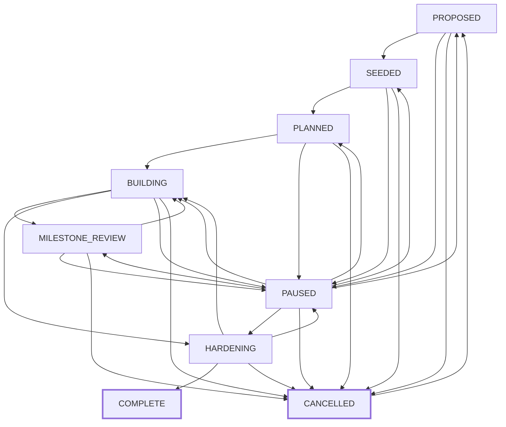
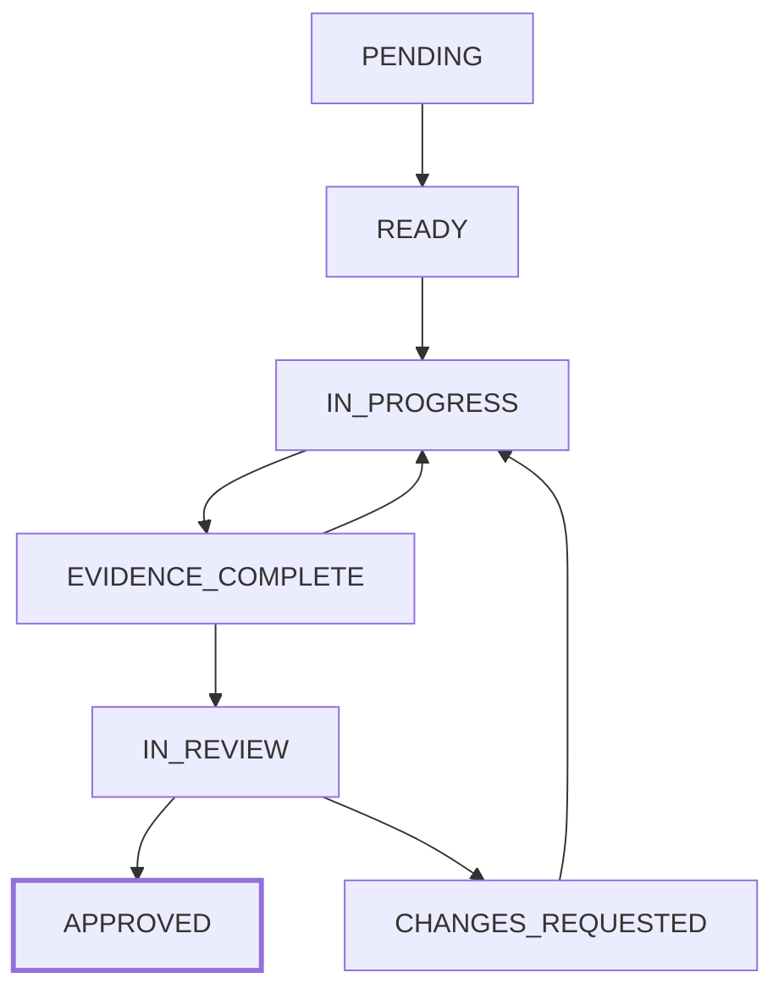
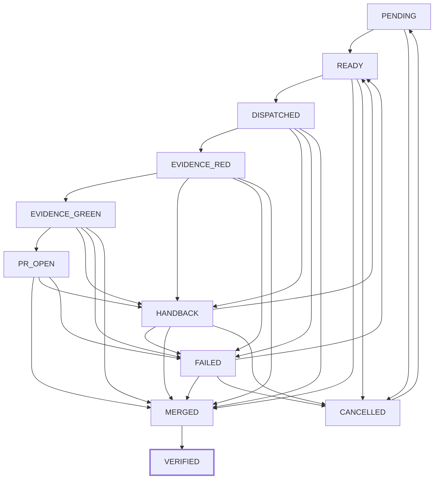

# Rebuild programme lifecycle

The three state machines that drive a rebuild programme:
a **programme** contains **milestones**, each milestone's spec derives a
dependency-ordered graph of **build tasks**. The diagrams below are
generated from the live adjacency tables — edit
`src/*-state-machine.ts` and run `npm run graph:programme -w @lexi/programme`
to regenerate; CI runs the `--check` variant.

Human gates, by construction rather than convention:

- `Milestone.APPROVED` is reachable only from `IN_REVIEW`, and the only edge
  into it is the Block Kit approval click (`programme.milestone.approve`).
- `Programme.COMPLETE` is reachable only from `HARDENING`, and the hardening
  gate requires a human `hardening.conclude` plus zero open hardening findings.
- Auto-merge is not a state here at all: it is a deterministic executor in
  the advance job, gated by `evaluateAutoMergeGate`. Merging is allowed only
  in a repository registered with `autonomyTier: autonomous`.

<!-- BEGIN GENERATED PROGRAMME GRAPH -->

<!-- Generated by `npm run graph:programme -w @lexi/programme`. Do not edit by hand — edit
     TRANSITIONS in packages/programme/src/*-state-machine.ts and regenerate. -->

### Programme

- **9 states**, **28 legal transitions** (guarded by `ProgrammeStateMachine.assertTransition`).
- Terminal states: `COMPLETE`, `CANCELLED`.

### Milestone

- **7 states**, **8 legal transitions** (guarded by `MilestoneStateMachine.assertTransition`).
- Terminal states: `APPROVED`.

### Build task

- **11 states**, **29 legal transitions** (guarded by `BuildTaskStateMachine.assertTransition`).
- Terminal states: `VERIFIED`.

<!-- END GENERATED PROGRAMME GRAPH -->
