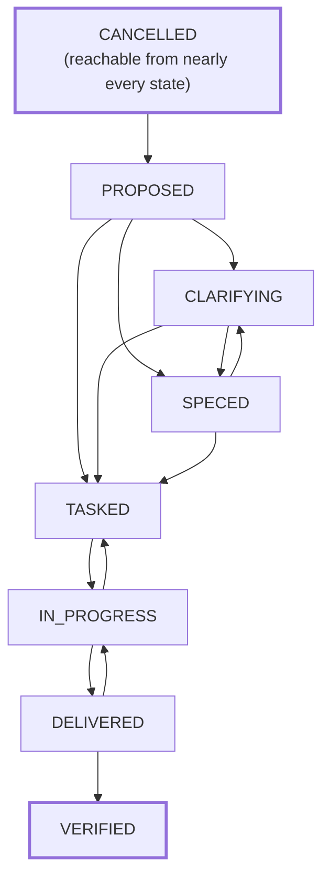

# Work item lifecycle

A **work item** is a unit of work that is not necessarily a bug — a feature, a
chore, or a spec. It exists because forcing all of those through the 20-state
bug workflow is what made Lexi a bug-shaped triage pipeline.

This machine is deliberately **small and separate**. A bug work item
*references* a workflow execution in `packages/workflows` (via its issue
number); it does not inherit that machine's states. Nothing here knows what
`SENT_TO_REPRODUCTION` or `RETEST` mean, because those are properties of
reproducing a defect, not of doing work.

Two repo keys travel with every item, on purpose:

- `trackingRepoKey` — where the issue lives (role `issues`, or `specs` for a spec)
- `codeRepoKey` — where the change lands (role `code`)

For a bug those differ (`issues` vs. a product repo). For a spec they
are the same product repo. See `config/repos.yaml`.

## States

<!-- BEGIN GENERATED WORK ITEM GRAPH -->

<!-- Generated by `npm run graph:workitem -w @lexi/workitems`. Do not edit by hand — edit
     TRANSITIONS in packages/workitems/src/work-item-state-machine.ts and regenerate. -->

- **8 states**, **19 legal transitions** (guarded by `WorkItemStateMachine.assertTransition`).
- `CANCELLED` is reachable from every non-terminal state and is drawn without inbound edges for legibility.
- Terminal states: `VERIFIED`, `CANCELLED`.
- Revivable states (restart the lifecycle at `PROPOSED`): `CANCELLED`.
- This machine is **separate from** the 20-state bug workflow in `packages/workflows`. A bug work item *references* a workflow execution; it does not inherit its states.

<!-- END GENERATED WORK ITEM GRAPH -->

## Verification

`VERIFIED` is reachable only from `DELIVERED`, and for a feature it means a
**deployment record exists** — not that a bug retest passed. That is why
`ImplementationLink` / `ReleaseRecord` / `DeploymentRecord` are re-keyed onto
`workItemId`: keyed on `productionIssueNumber`, a feature could never attach one.
